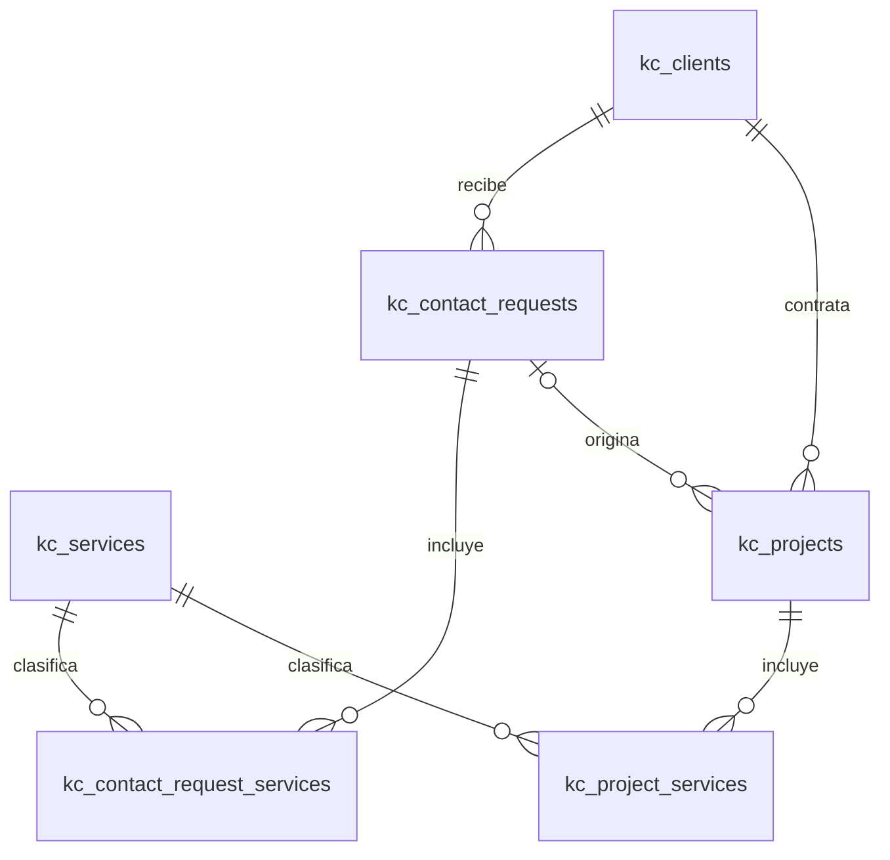

# Base de datos

## Modelo



- `kc_clients`: datos de contacto, con unicidad de correo sin distinguir mayúsculas.
- `kc_services`: catálogo canónico compartido por solicitudes y proyectos.
- `kc_contact_requests`: mensajes recibidos, estado comercial, trazabilidad del límite de uso y entrega de correo.
- `kc_contact_request_services`: servicios solicitados en cada contacto.
- `kc_projects`: proyectos y su ciclo de vida, vinculables a una solicitud.
- `kc_project_services`: servicios contratados por proyecto.

El esquema central está en `supabase/migrations/20261120000000_core_schema.sql` y usa Postgres estándar, más `pgcrypto` para UUID. La migración `20261120000100_supabase_security.sql` solo corresponde a Supabase: habilita RLS sin políticas públicas y concede RPC al rol de servicio. Omitirla en otro proveedor y aplicar allí los permisos apropiados.

## Preparar para futuros proyectos

Agrega servicios al catálogo sin cambiar el contrato de solicitudes. Cada solicitud puede originar cero o varios proyectos; cada proyecto puede combinar servicios. Los datos personales del cliente viven una sola vez en `kc_clients`, mientras que cada contacto conserva su propio mensaje y estado. Conserva los nombres `kc_*` de tablas y funciones para evitar colisiones con otros módulos.

## Migración a otro Postgres

Aplica únicamente el esquema central y revisa que el proveedor permita instalar `pgcrypto`. No ejecutes la migración específica de Supabase. Para respaldos desde una instalación PostgreSQL:

```sh
pg_dump --format=custom --no-owner --no-acl --file=kodastudio.dump "$DATABASE_URL"
pg_restore --no-owner --no-acl --dbname="$TARGET_DATABASE_URL" kodastudio.dump
```

Para llevar solo este esquema, exporta el esquema `public` filtrando el esquema de la aplicación según tu política de migración; documenta y configura por separado roles, permisos y secretos del nuevo proveedor.
